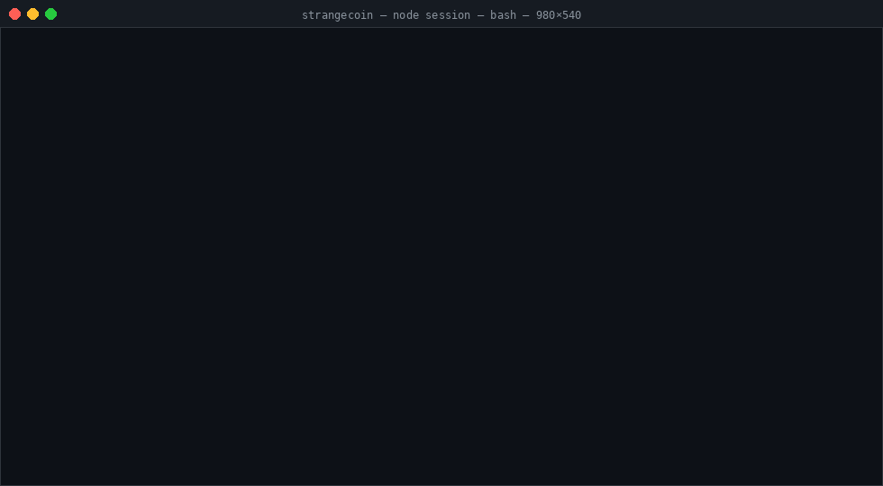
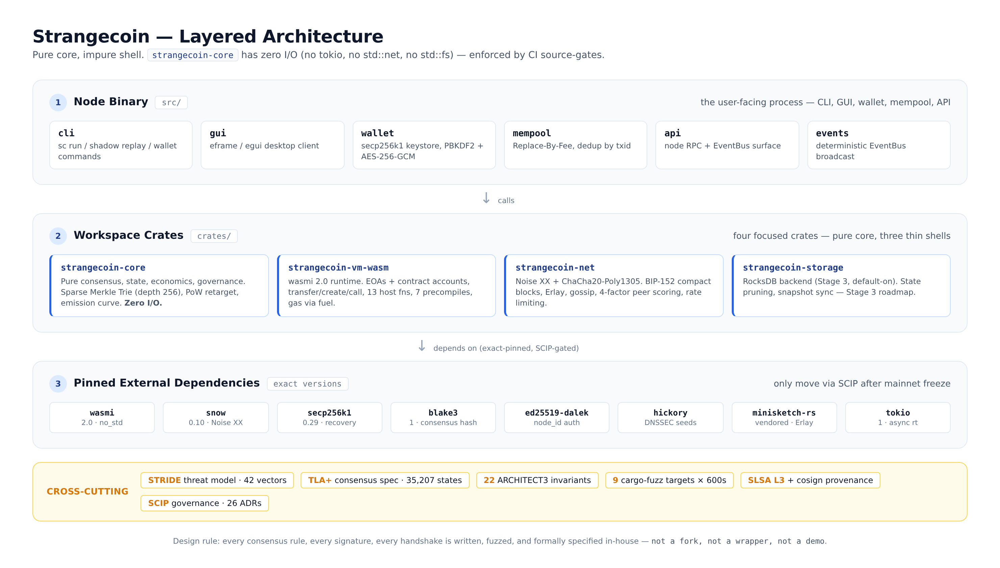

# Strangecoin

**Production-grade Layer-1 blockchain in Rust for AI agents — MCP-native, Noise-encrypted P2P, WASM smart contracts, Erlay.**



[](https://github.com/Reider85/strangecoin/actions/workflows/ci.yml)
[](https://github.com/Reider85/strangecoin/actions/workflows/release.yml)
[](https://github.com/Reider85/strangecoin/actions/workflows/nightly.yml)
[](https://github.com/Reider85/strangecoin/releases)
[](LICENSE)
[](https://www.rust-lang.org)
[](https://www.rust-lang.org/)
[](https://github.com/Reider85/strangecoin/releases)
[](https://github.com/Reider85/strangecoin/search?l=rust)
[](#prerequisites)
[](https://github.com/Reider85/strangecoin/stargazers)
[](https://github.com/Reider85/strangecoin/releases)
[](docs/SCIP/scip-0001-genesis-key-replacement.md)
[](docs/ADR/0028-strangecoin-as-cryptocurrency-for-ai-agents.md)
[](#contributing)
[](https://github.com/Reider85/strangecoin/actions/workflows/nightly.yml)
[](https://github.com/Reider85/strangecoin/actions/workflows/nightly.yml)
[](https://reider85.github.io/strangecoin/)

---

### What is Strangecoin?
A production-grade Layer-1 blockchain written from scratch in Rust, designed specifically for AI agents with native MCP and ACP support.

### Why Choose Strangecoin?
- **AI-First**: Built from the ground up for autonomous economic agents
- **Production-Ready**: Full cryptocurrency with PoW consensus, WASM smart contracts
- **Privacy-First**: Noise-encrypted P2P networking with Erlay reconciliation
- **Developer-Friendly**: Comprehensive documentation and tooling

---

## Introduction

Strangecoin is a **full cryptocurrency written from scratch in Rust** — and **a cryptocurrency for AI agents**. It is not a fork of any existing coin — the address format (`rsc1` bech32), chain IDs, genesis block, consensus parameters, network protocol and improvement process are all native to this project.

> **AI-agent orientation.** Strangecoin is engineered for autonomous economic agents: wallets are first-class agent identities (programmable key derivation, batched/sponsored txs, gasless UX via paymasters in Stage 5), the node exposes itself as an **MCP server** (tools: `get_block`, `get_balance`, `submit_tx`, `call_contract`, `subscribe_events`), and the protocol supports **ACP** (Agent Communication Protocol) messages so agents can negotiate, settle, and route payments peer-to-peer without a centralized coordinator. See [ADR-0028](docs/ADR/0028-strangecoin-as-cryptocurrency-for-ai-agents.md), [ADR-0029](docs/ADR/0029-mcp-server.md), [ADR-0030](docs/ADR/0030-acp-agent-communication-protocol.md).

### Built for AI Agents

Strangecoin is engineered so that autonomous economic agents are first-class participants:

- **MCP (Model Context Protocol) server** — the node exposes itself as an [MCP](https://modelcontextprotocol.io) server over stdio + HTTP+SSE, serving chain state as tools (`get_block`, `get_balance`, `get_nonce`, `submit_tx`, `call_contract`, `estimate_fee`, `subscribe_events`) and resources (`chain://tip`, `chain://block/{h}`, `chain://tx/{txid}`, `chain://contract/{addr}`). Any MCP-capable LLM (Claude, GPT, Gemini, open-weight via `mcp-cli`) reads on-chain state and submits transactions without a custom plugin.
- **ACP (Agent Communication Protocol)** — a wire message family (`ACP_NEGOTIATE`, `ACP_TASK`, `ACP_SETTLE`, `ACP_REVOKE`) rides on top of the existing Noise-authenticated P2P layer so agents can negotiate tasks, quote and pay for services, and settle micropayments peer-to-peer — without a centralized marketplace.
- **Agent identity = wallet identity** — secp256k1 EOA (same curve as MetaMask/Ledger), HD derivation, key isolation, batched and sponsored txs via WASM contracts.

### What Makes It Different

Most "learn blockchain" tutorials end at a 200-line `Block` struct. Strangecoin goes further and ships:

- a **PoW blockchain** with persistent RocksDB storage
- a **tokio-driven P2P layer** — Noise handshake, gossip, compact blocks, Erlay reconciliation
- an **in-protocol WASM virtual machine** for smart contracts
- an **MCP server + ACP transport + agent SDK** (Stage 4) — the AI-agent-native surface
- comprehensive **ADR + SCIP governance trail** — every non-trivial decision is recorded

---

## Quick Start

### Prerequisites

- Rust 1.74+ (edition 2021)
- Cargo (comes with Rust)
- OpenSSL development headers

### Build and Run

```bash
# Clone the repository
git clone https://github.com/Reider85/strangecoin.git
cd strangecoin

# Build the project
cargo build --release

# Run the node
cargo run --release -- --headless
```

### Development

```bash
# Run tests
cargo test --workspace

# Run with GUI (default)
cargo run

# Run headless (server mode)
cargo run -- --headless
```

---

## Testing

Strangecoin has comprehensive test coverage:

```bash
# Run all tests
cargo test --workspace

# Run specific test categories
cargo test --lib              # Unit tests only
cargo test --test '*'         # Integration tests only
cargo test --doc              # Documentation tests

# Run with verbose output
cargo test -- --test-threads=1 --nocapture
```

---

## Architecture



**Pure core, impure shell.** `strangecoin-core` has zero I/O — no `tokio`, no `std::net`, no `std::fs`, enforced by CI source-gates — so the consensus rules can be reasoned about, fuzzed, and embedded without dragging a runtime or a database with them. The binary, the VM, the network, and storage are thin shells that pull from the core.

### Project Structure

```
crates/
├── strangecoin-core/      # Pure consensus logic (0 I/O)
├── strangecoin-net/       # P2P networking (Noise, gossip, Erlay)
├── strangecoin-vm-wasm/   # WASM smart contracts (wasmi)
├── strangecoin-storage/   # Storage engine (RocksDB)
src/
├── lib.rs                # Main binary and orchestration
├── blockchain/           # Blockchain facade
├── network/              # Network interface
├── mempool/              # Transaction mempool
└── wallet/               # Key management
```

### Key Features

| Feature | Implementation |
|---------|----------------|
| **Consensus** | PoW with retargeting, MTP validation |
| **Network** | Noise XX handshake, ChaCha20-Poly1305, peer scoring |
| **Storage** | RocksDB with column families, versioning |
| **VM** | wasmi 2.0 with 13 host functions |
| **Crypto** | secp256k1, blake3, AES-GCM, PBKDF2 |

---

## Roadmap

### Stage 3 (Current): Storage and Scalability
- [x] Storage schema and engine (RocksDB)
- [x] State pruning strategy
- [x] Snapshot sync format
- [ ] Indices and performance optimization
- [ ] Stateless validation witnesses

### Stage 4: Developer Experience
- [ ] Professional UI replacement
- [ ] SDK and devnet
- [ ] JSON-RPC surface
- [ ] Documentation website

### Stage 5: Advanced Features
- [ ] Account abstraction
- [ ] Dynamic fee market
- [ ] Threshold encryption mempool

### Stage 6+: Research and Production
- [ ] TLA+ formal verification
- [ ] ZK-VM integration
- [ ] Mainnet launch (after SCIP-0001)

---

## Contributing

We welcome contributions! Please see our [Contributing Guidelines](CONTRIBUTING.md) for details.

### Getting Started

1. Fork the repository
2. Create a feature branch (`git checkout -b feature/amazing-feature`)
3. Make your changes
4. Add tests for your changes
5. Ensure all tests pass (`cargo test`)
6. Commit your changes (`git commit -m 'feat: add amazing feature'`)
7. Push to the branch (`git push origin feature/amazing-feature`)
8. Open a Pull Request

### Development Workflow

- Follow the [commit message format](CONTRIBUTING.md#commit-messages)
- Run tests before submitting PRs
- Update documentation for new features
- Join our [Discussions](https://github.com/Reider85/strangecoin/discussions)

---

## Star History

[](https://starchart.cc/Reider85/strangecoin)

---

## Support

- **Documentation**: [GitHub Pages](https://reider85.github.io/strangecoin/)
- **Issues**: [GitHub Issues](https://github.com/Reider85/strangecoin/issues)
- **Discussions**: [GitHub Discussions](https://github.com/Reider85/strangecoin/discussions)
- **Security**: [Security Policy](SECURITY.md)

---

## License

Licensed under the **Apache License, Version 2.0**. See [LICENSE](LICENSE) for the full text.

```
SPDX-License-Identifier: Apache-2.0
```

> The Apache-2.0 license covers the **source code**. It does **not** grant any right to operate a mainnet — the genesis key is burned, and mainnet is gated behind [SCIP-0001](docs/SCIP/scip-0001-genesis-key-replacement.md).

---

## Acknowledgements

Strangecoin stands on the shoulders of many open-source projects:

- **[Rust](https://www.rust-lang.org/)** & **[tokio](https://tokio.rs)** async runtime
- **[egui / eframe](https://github.com/emilk/egui)** — the GUI framework
- **[rusty-leveldb](https://crates.io/crates/rusty-leveldb)** — pure-Rust LevelDB
- **secp256k1**, **blake3**, **aes-gcm**, **pbkdf2** — cryptographic primitives
- **[minisketch](https://github.com/sipa/minisketch)** — Erlay set reconciliation
- Bitcoin's P2P protocol design and BIP-style improvement proposals

Protocol design decisions are recorded as ADRs under [`docs/ADR/`](docs/ADR) and as SCIPs under [`docs/SCIP/`](docs/SCIP).

---

*Built with Rust, blake3, secp256k1, wasmi, Noise, MCP, ACP, and a refusal to ship "almost."*

**Star it · Fork it · Try to break it · Point your agents at it.**

If Strangecoin helped you learn or build, please [star the repo](https://github.com/Reider85/strangecoin/stargazers) — it really helps.⭐ null stars
