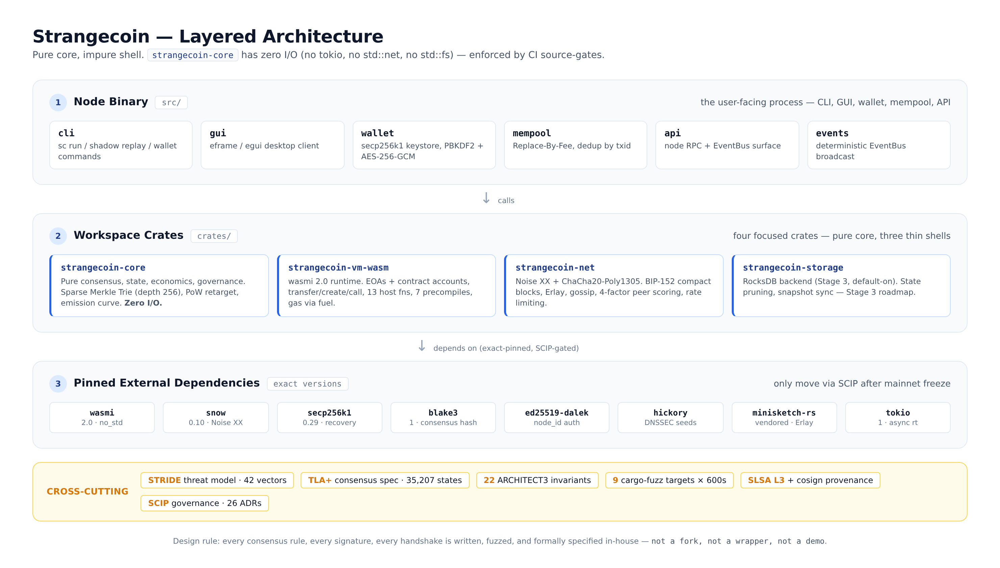

# Launch Stage 3 — announcement drafts (GITHUB.md P5)

> **Purpose:** ready-to-paste announcement drafts for the `v3.0.0-stage3`
> launch day. Execution order and timing live in `launch-runbook.md`;
> readiness gates live in `trending-checklist.md`.
>
> **Language:** bodies are in English — the target audiences (Hacker News,
> r/rust, dev.to) are English-speaking. Editorial notes are in Russian.
>
> **Deviations from the P5 spec (documented explicitly per FBP):**
>
> 1. **Show HN title.** The spec's suggested hook
>    (`Show HN: Strangecoin — a Layer-1 blockchain in Rust built for AI
>    agents (MCP/ACP-native)`) is **88 characters** while the same spec
>    demands **≤ 80 char**. The title below is a trim of that hook keeping
>    every keyword (Layer-1, blockchain, Rust, AI agents, MCP/ACP) at
>    **≤ 80 char** (verified: see §1).
> 2. **Drafts are not scheduled by this file** — posting times are a
>    human action on launch day (runbook T=0 / T+15m). Nothing here is
>    auto-posted by CI.
> 3. **Counts** (HN ≤ 80 char title, ≤ 1500 char body; dev.to 3000–4000
>    words) are verified as part of the P5 acceptance check.

---

## 1. Show HN post

**Заголовок (≤ 80 char, verified):**

```text
Show HN: Strangecoin — a Layer-1 blockchain in Rust for AI agents (MCP/ACP)
```

**Body (≤ 1500 char, verified — copy everything inside the fence):**

```text
Strangecoin is a proof-of-work Layer-1 blockchain written from scratch in Rust — 99.3% Rust, edition 2021, no forks of Bitcoin or Ethereum. What works today: WASM smart contracts (wasmi, gas metering, JSON ABI), Noise-encrypted P2P (XX handshake, gossip, compact blocks, Erlay reconciliation, peer scoring), RocksDB storage with a one-shot LevelDB migration, secp256k1 wallets with bech32 addresses, headers-first sync, and a CLI/GUI node.

Where it differs from Solana or Ethereum: the VM is part of the protocol, the entire P2P layer is Noise-authenticated end to end, and the node ships an MCP server — any MCP-capable LLM (Claude, GPT, local models) can read chain state and submit transactions through standard tools like get_block, get_balance and call_contract with zero custom plugins. Agents can also negotiate and settle payments peer-to-peer over ACP messages.

Code: https://github.com/Reider85/strangecoin
Docs: https://reider85.github.io/strangecoin/
Discussions: https://github.com/Reider85/strangecoin/discussions

Testnet-only, genesis burned, not for real value.
```

**Редакторские заметки (не публиковать):**
- Первый абзац = «что это + что работает сегодня» (спека P5, блок 1).
- Второй = «чем отличается от Solana / Ethereum»: свой VM, Noise-encrypted
  P2P, MCP server (+ ACP как bonus).
- Третий = ссылки GitHub + GitHub Pages + Discussions.
- Финал = «testnet-only, genesis burned, not for real value» (дословно
  по спеке).
- Публиковать в **09:00 PT** launch-дня (см. runbook T=0); на HN лучше
  вторник–четверг, избегать пятницы/субботы.

---

## 2. r/rust пост

**Заголовок:**

```text
I built Strangecoin: a Layer-1 blockchain in Rust, from scratch — MCP-native for AI agents
```

**Body:**

```markdown
Hey r/rust! I've been building [Strangecoin](https://github.com/Reider85/strangecoin)
— a full Layer-1 blockchain written **from scratch in Rust**: 99.3% Rust,
edition 2021, zero code forked from Bitcoin, Ethereum or any other chain.
Address format (bech32), chain IDs, genesis, consensus parameters, wire
protocol and the improvement process (SCIP) are all native to this project.

**What's in the box today:**

- **Consensus** — PoW with difficulty retargeting, median-time-past
  validation, sparse Merkle state roots, receipts root in the block header,
  and a TLA+ model of the consensus rules (35k+ states checked in CI).
- **Smart contracts** — in-protocol WASM VM (wasmi 2.0) with gas metering,
  JSON ABI, 13 host functions, 7 precompiles and a reentrancy guard.
- **P2P** — Noise XX handshake (ChaCha20-Poly1305), Ed25519 node identity,
  INV gossip, BIP-152-style compact blocks, Erlay-style reconciliation,
  4-factor peer scoring and token-bucket rate limiting.
- **Storage** — RocksDB with column families and schema versioning,
  per-block incremental writes, one-shot LevelDB migration.
- **AI-agent surface** — the node is an MCP server (stdio + HTTP/SSE), so
  any MCP-capable LLM can read chain state and submit transactions through
  standard tools; ACP messages let agents settle payments peer-to-peer.

The architecture follows "pure core, impure shell": `strangecoin-core` has
**zero I/O** (no tokio, no fs, no net — enforced by CI source gates), and
the binary/VM/network/storage are thin shells around it.

Links:
- Repo: https://github.com/Reider85/strangecoin
- Docs/landing: https://reider85.github.io/strangecoin/
- Discussions: https://github.com/Reider85/strangecoin/discussions

Status: testnet-only, genesis burned, not for real value. Feedback on the
Rust side (tokio architecture, wasmi integration, RocksDB schema) very
welcome!
```

**Редакторские заметки (не публиковать):**
- Акцент спеки P5: «написано с нуля в Rust, 99.3% Rust, edition 2021,
  без fork-ов от Bitcoin/Ethereum» — во втором абзаце и в заголовке.
- Формат reddit: markdown, ссылки полными URL.
- Публиковать **T+15m** после HN (см. runbook); кросс-постить в
  r/CryptoCurrency и lobste.rs тем же окном.

---

## 3. dev.to статья (длинная, 3000–4000 слов)

**Заголовок:**

```text
Strangecoin: a Layer-1 blockchain in Rust, built from scratch for AI agents
```

**Front matter (dev.to YAML):**

```yaml
---
title: "Strangecoin: a Layer-1 blockchain in Rust, built from scratch for AI agents"
published: false
date: <T-7d date>
description: "How a pure-core Rust L1 with a WASM VM, Noise-encrypted P2P and a native MCP server fits together — architecture, code walkthrough, roadmap."
tags: rust, blockchain, webassembly, ai, security
---
```

> ⚠️ Публиковать на **T-7d** (за неделю до launch-дня) — длинный контент
> должен успеть проиндексироваться до всплеска (см. runbook).

---

### Article body

````markdown


## TL;DR

Strangecoin is a proof-of-work Layer-1 blockchain written from scratch in
Rust — 99.3% Rust, edition 2021, no code forked from Bitcoin or Ethereum.
It ships a WASM smart-contract VM (wasmi 2.0) inside the protocol, a
Noise-encrypted P2P layer with gossip, compact blocks and Erlay-style
reconciliation, RocksDB storage with schema versioning, and — the part that
motivated the whole project — a **native MCP server**, so any MCP-capable
LLM can read chain state and submit transactions without a custom plugin.
This post walks through why it exists, how the pieces fit, what the code
looks like, and what's next.

## Why another blockchain?

Every few months someone announces "the blockchain for AI agents." Most
of those are EVM testnets with a wrapper API and a blog post. The
question this project actually tries to answer is narrower and more
boring: **what has to be true about a chain's design before an
autonomous agent can use it as infrastructure rather than as a
demo?** The answers below shaped every layer — from the key hierarchy to
the wire protocol — and they are the reason Strangecoin exists instead
of yet another fork.

### The agent economy needs a settlement layer that agents can actually use

Autonomous AI agents are increasingly doing real work: running jobs,
trading compute, paying other agents for services. Today they do that
through custodial APIs and credit cards — everything *around* a
blockchain, rather than a blockchain itself. If you want an agent to hold
value, pay for a task and get paid for one, you need three things:

1. **A wallet that is a first-class identity.** Not an exchange account —
   a keypair the agent owns, with programmatic derivation and the ability
   to sponsor or batch transactions.
2. **A protocol the agent can speak.** Not a JSON-RPC wrapper someone
   bolted on, but a message surface designed so that an LLM-driven client
   can negotiate, quote and settle without human glue code.
3. **A chain that is cheap and predictable to run.** A full node an
   operator can sync in reasonable time, with a storage engine that can be
   pruned and snapshotted.

Strangecoin is built around those three requirements. The node exposes
itself as an **MCP (Model Context Protocol) server** over stdio and
HTTP+SSE, serving chain state as tools and resources; the wire protocol
carries **ACP (Agent Communication Protocol)** messages so agents can
negotiate tasks and settle micropayments peer-to-peer, with no
centralized marketplace in the middle.

### Why from scratch?

The short answer: every existing chain makes at least one compromise that
matters here.

- Fork an EVM chain and you inherit the EVM, its gas model and its
  account model — fine for DeFi, awkward for an agent-native design where
  identity, sponsored transactions and batched calls are first-class.
- Fork Bitcoin and you inherit a scripting model that was never meant to
  host a general-purpose VM.
- Build on someone else's L1 and their roadmap, fee market and
  governance become your constraints.

So Strangecoin defines its own: bech32 addresses, chain IDs, genesis,
consensus parameters, wire protocol, and a written improvement process
(SCIP) that mirrors BIPs. Nothing about the project is a copy — the
`sc1`/`rsc1` address format, the block header layout with a receipts
root, and the Noise-based peer protocol are native designs, reviewed
against known attack surfaces rather than inherited wholesale.

There is also a practical reason: **a chain you fully understand is a
chain you can reason about.** The consensus core is deliberately tiny and
pure, which is what makes it fuzzable, model-checkable and embeddable.

## How it works

### Pure core, impure shell

The single most important architectural rule: `strangecoin-core` has
**zero I/O**. No `tokio`, no `std::net`, no `std::fs`, no database —
enforced not by convention but by CI source gates that fail the build if
those imports show up in the core crate.

Everything else is a thin shell around it:

```text
crates/
├── strangecoin-core/      # Pure consensus logic (0 I/O)
├── strangecoin-net/       # P2P networking (Noise, gossip, Erlay)
├── strangecoin-vm-wasm/   # WASM smart contracts (wasmi)
├── strangecoin-storage/   # Storage engine (RocksDB)
src/                       # The node binary: orchestration, wallet, GUI
```

Why care? Because consensus code that cannot reach the clock, the network
or the filesystem is *deterministic by construction*. The same block
sequence produces the same state root on every machine. The project takes
this further with explicit determinism checklists for every network and
storage feature (no wall-clock in hot paths, no OS RNG in handshakes,
sorted iteration everywhere), and a TLA+ model of the consensus rules
(`docs/spec/consensus.tla`) that checks invariants like receipts-root
matching over ~35,000 states.

### Consensus

PoW with:

- **Difficulty retargeting** on a fixed interval, plus **median-time-past**
  validation so timestamps cannot be trivially manipulated.
- **Fork choice** by cumulative work → timestamp → hash (a total order,
  no ambiguity).
- **Sparse Merkle state root** in the header, and — since ADR-0016 — a
  **receipts root**, so execution results are committed without bloating
  blocks.
- **Canonical binary serialization** (blake3-based) for everything
  consensus-critical; JSON is used only for config, tooling and ABI
  documents.

### What happens when a block arrives

A quick walk through the hot path, because it shows how the layers
compose: the network shell decrypts the frame and hands the block to the
node; the header is checked first — proof of work against the expected
target, median-time-past, parent hash, and fork-choice position
(cumulative work, then timestamp, then hash). Transactions are
signature-checked against the parent state, executed under the block gas
limit, and the resulting state root and receipts root must equal the
ones committed in the header — mismatch means rejection, never
"best-effort" adoption. Only then does the storage shell persist the
per-block diff (changed records plus state-history capture), the mempool
drops included transactions, and the event bus notifies subscribers —
including the gossip announcer, which relays the block to peers. A
rejected block is not silent: it feeds the peer's scoring record, and
enough invalid blocks climb the ban ladder. Every step is pure core or
a thin shell around it, which is why the same block yields the same
result on every machine in the network.

### Storage

The storage layer is a workspace crate (`strangecoin-storage`) behind a
`StorageEngine` trait, with RocksDB as the production backend:

- **Seven column families** (schema version 1) separating blocks,
  headers, state, indices, mempool, state history and metadata.
- **Per-block incremental writes**: on each adopted block the node writes
  only the changed records plus a common-ancestor diff against snapshots,
  instead of rewriting the world.
- **Schema-version guard, fail-closed**: a database written by a
  different schema version refuses to open rather than silently
  misinterpreting bytes.
- **One-shot LevelDB → RocksDB migration** with a parse-all-first,
  atomic-rename design — corrupt fixtures fail the migration loudly and
  leave the legacy directory untouched (it's kept as `.leveldb.bak` for
  rollback).
- **Pruning and snapshots** are specified (ADR-0025 height-window pruning
  with an archival mode; ADR-0026 commitment-verified snapshot sync) —
  they land as the current stage of the roadmap closes.

### P2P networking

The network layer is where a lot of blockchains quietly cut corners.
Strangecoin's stack:

- **Noise Protocol Framework, XX pattern** — mutual auth with
  ChaCha20-Poly1305 transport encryption (via `snow`), Ed25519 static
  keys for node identity, ephemeral keys derived from a long-term seed
  through HKDF (deterministic per node start: reproducible *and* forward
  secret within a run).
- **Gossip via INV/GET_DATA**, **BIP-152-style compact blocks** (short
  IDs derived deterministically from the block hash — no random nonces,
  because determinism beats spec-literalism here), and **Erlay-style
  set-reconciliation** for mempool sync with a documented
  capacity-bounded fallback when the minisketch feature is off. The
  reconciliation idea is the interesting part: instead of pushing every
  transaction to every peer, both sides exchange small sketches of their
  mempool sets and derive only the *difference* — in the modeled case,
  two peers sharing 800 of 1000 transactions transmit ~200, an 80%
  bandwidth reduction. When the sketch path is unavailable, the node
  falls back to chunked INV announce, so correctness never depends on the
  optimization.
- **Peer scoring** — a four-factor weighted formula with a ban state
  machine (warn → temp ban → persistent ban), and **token-bucket rate
  limiting** per peer and per message type.
- **Peer discovery** with DNSSEC-validated seeds plus ADDR gossip, so the
  peer set is never sourced from a single untrusted channel.

Every one of these features carries a determinism checklist in its
review: identical inputs must produce identical outputs, and clocks are
injected only at the edges.

### The WASM VM

Smart contracts are WebAssembly, executed by **wasmi 2.0** (pinned):

- **Gas metering** with hardcoded constants (changing them is a
  consensus change — SCIP + activation height only, post-freeze).
- **JSON ABI** with head/tail encoding and blake3-derived method
  selectors; golden vectors pin the wire format.
- **13 host functions** across crypto/storage/calls/context/logs, and
  **7 precompiles** (0x01–0x07; the BLS aggregate one is reserved).
- **Reentrancy guard**, code-size limits, block gas limits, receipts and
  events persisted per call.

Contracts live in the same sparse Merkle state as accounts, so a
contract's storage root is committed by the same state root as
everything else.

### Wallets and keys

Two key systems, deliberately kept apart:

- **Wallet keys are secp256k1** — the same curve as Bitcoin and MetaMask,
  so standard tooling and mental models apply. Keys live in an encrypted
  keystore (PBKDF2 key derivation + AES-GCM), unlocked by
  `STRANGECOIN_WALLET_PASSWORD` or an interactive prompt; the password
  never appears in a config file. Addresses are bech32 (`rsc1…`), which
  gives typo detection for free.
- **P2P identity keys are Ed25519** — a separate keystore namespace
  (`keystore/node/`) derives the Noise static key and the node ID
  (blake3 of the public key). Mixing these two key types is a classic
  source of bugs, so the codebase makes the separation structural rather
  than conventional: different directories, different types, different
  code paths.

For agents, the wallet *is* the identity: programmatic derivation,
batched transactions and (Stage 5) sponsored/gasless flows all hang off
the same secp256k1 account.

### Mempool, fees and the deterministic clock

The mempool is replace-by-fee capable: a transaction can be superseded
by a higher-fee version of the same spend — exactly the behavior an
automated fee-bidding agent needs. Fees today follow a simple market
(the dynamic fee market is a Stage 5 item), and every block carries a
gas limit enforced at execution time.

The subtle rule that ties everything together is the **deterministic
clock**: consensus time comes from block headers (timestamps,
median-time-past), never from `SystemTime::now()`. Wall-clock time
appears only at system edges — ban expiry, cache TTLs — where it is
injected as an explicit parameter (`tick_at(now)`, `reconcile_at(now)`)
so tests run against a simulated clock with zero sleeps. The same
discipline applies to RNG: no `thread_rng` in handshake, sketch or
scoring paths; keys derive from seeds via HKDF. This is not aesthetic
puritanism — non-determinism in a blockchain is a consensus bug waiting
to fork the network.

### The agent surface: MCP + ACP

Two standards, used natively:

**MCP server.** The node serves tools like `get_block`, `get_balance`,
`get_nonce`, `submit_tx`, `call_contract`, `estimate_fee`,
`subscribe_events`, and resources like `chain://tip`,
`chain://block/{h}`, `chain://tx/{txid}`. Any MCP-capable client —
Claude Desktop, a local model over `mcp-cli`, your own agent loop — can
talk to a running node with zero glue code. This is the "wallet as
identity" story: the same secp256k1 keys an agent holds are the keys the
chain knows.

**ACP messages.** `ACP_NEGOTIATE`, `ACP_TASK`, `ACP_SETTLE`,
`ACP_REVOKE` ride on top of the existing Noise-authenticated P2P layer.
Agents can quote a task, agree on a price and settle payment
peer-to-peer — the transport is already encrypted and authenticated, so
the marketplace is a message family, not a company.

## Code walkthrough

### Build and run

```bash
git clone https://github.com/Reider85/strangecoin.git
cd strangecoin
cargo build --release

# headless node (server mode)
cargo run --release -- --headless

# GUI client (default feature set)
cargo run
```

Requirements: Rust 1.74+ (edition 2021) and OpenSSL headers. The wallet
password comes from `STRANGECOIN_WALLET_PASSWORD` or an interactive
prompt — never from a config file.

### Run the test suite

```bash
cargo test --workspace          # everything
cargo test --lib                # unit tests
cargo test --test '*'           # integration tests
cargo test --doc                # doctests
```

Property tests (`proptest`) cover the consensus rules, fork choice, state
round-trips and the ABI codec; a fuzzing harness runs nine targets
(canonical decode, host functions, gas metering, storage trie, a wasmi vs
wasmtime differential oracle, and four network targets) on a nightly
schedule.

### What a transaction looks like

```rust
// Conceptual shape — see crates/strangecoin-core/src/types.rs
enum Transaction {
    Transfer { to: Address, amount: U256, /* ... */ },
    Create   { code: Vec<u8>, abi: AbiDocument, /* ... */ },
    Call     { to: Address, input: Vec<u8>, /* ... */ },
}
```

Transfers move value; `Create` deploys WASM; `Call` invokes a contract
through the JSON ABI codec. Every transaction carries a secp256k1
signature over the canonical serialization — the same bytes that feed
the blake3 transaction root.

### What a contract ABI looks like

Contracts publish a JSON ABI document; the method selector is the first
four bytes of a blake3 hash of the signature, head/tail encoding handles
dynamic types, and golden-vector tests pin the exact wire bytes so a
codec change can never silently break deployed contracts:

```json
{
  "name": "escrow",
  "methods": [
    {
      "name": "open",
      "inputs": [
        { "name": "counterparty", "type": "address" },
        { "name": "amount", "type": "uint256" }
      ],
      "outputs": [{ "name": "escrow_id", "type": "bytes32" }]
    },
    {
      "name": "release",
      "inputs": [{ "name": "escrow_id", "type": "bytes32" }],
      "outputs": [{ "name": "ok", "type": "bool" }]
    }
  ]
}
```

Calling `open` from a test looks like any other transaction — build the
calldata with the codec, sign it, submit it — and the resulting receipt
(computed gas, status, events) is committed under the receipts root in
the next block header.

### Talking to the node over MCP

Once the node is running with the MCP server enabled, a client config
looks like any other MCP server:

```json
{
  "mcpServers": {
    "strangecoin": {
      "command": "strangecoin",
      "args": ["--headless", "--mcp"]
    }
  }
}
```

From there, an agent's tool calls are plain MCP calls — `get_balance` for
a read, `submit_tx` for a write, `subscribe_events` for a stream — no
custom SDK required. A read over HTTP+SSE looks like this:

```json
{
  "jsonrpc": "2.0",
  "id": 1,
  "method": "tools/call",
  "params": {
    "name": "get_balance",
    "arguments": { "address": "rsc1qzq0u8x2v3..." }
  }
}
```

```json
{
  "jsonrpc": "2.0",
  "id": 1,
  "result": {
    "content": [
      { "type": "text", "text": "{\"balance\":\"1250000000\",\"nonce\":7}" }
    ]
  }
}
```

Resources work the same way: subscribe to `chain://tip` for a head stream,
or fetch `chain://block/{height}` for a full block — an agent building a
watchtower or a market-making loop needs exactly these two primitives.
(The dedicated SDK, indexer and JSON-RPC `eth_*` surface are Stage 4
items; MCP works today.)

### Configuration

The node is configured through `config.toml` — peer tunables, storage
path, consensus allowances for regtest (`allow_grant_blocks`) — and
secrets stay out of it by construction: keystore files under
`keystore/wallet/` (secp256k1, PBKDF2 + AES-GCM) and `keystore/node/`
(Ed25519 for P2P identity) are encrypted on disk and never referenced
from config. The shape of it:

```toml
[storage]
path = "./data/rocksdb" # per-block schema, column families

[network]
default_port = 30303
dns_seeds = ["seed.example.org"]
dnssec_required = true        # reject non-Secure DNS answers

[peer_manager]
max_connections = 64
max_per_ip_range = 4          # Sybil cap: /24 (IPv4) or /64 (IPv6)

[consensus]
allow_grant_blocks = false    # true only on regtest / migration
```

Every value that influences consensus behavior is either a constant
pinned in code (changing it requires a SCIP + activation height) or an
explicit per-network override — there is no hidden global state.

## Five decisions worth stealing

If you take nothing else from this project, these are the ones that
saved us the most pain:

1. **Zero-I/O core, enforced by CI.** A source-gate script fails the
   build if `tokio`, `std::net` or `std::fs` appear in
   `strangecoin-core`. It costs one bash script in CI and buys a
   consensus layer you can fuzz, model-check and embed anywhere.
2. **Determinism checklists per feature.** Every network and storage
   feature lands with a written review: no wall clock in hot paths, no
   OS RNG in handshakes, sorted iteration everywhere, injected clocks at
   edges. The checklist is part of the definition of done, not a
   post-hoc audit.
3. **Fail-closed migrations.** The LevelDB → RocksDB migration parses
   the *entire* legacy database into memory first, writes to a temp
   directory, atomically renames, and keeps the original as `.bak`.
   Corrupt input means the node refuses to start — never a half-migrated
   database that misreads bytes as state.
4. **Pinned dependencies with a written policy.** Anything touching
   consensus, crypto or the wire format is pinned with `=` (wasmi,
   snow, rocksdb, ed25519-dalek…). After mainnet freeze, bumping a pin
   is a SCIP with an activation height, so every node upgrades in
   lockstep. It feels heavy-handed until the day a transitive dependency
   release would have forked your network.
5. **Differential oracles for the VM.** wasmi is the production
   runtime; wasmtime — never linked into the production binary — runs as
   a test-only differential oracle. When the two disagree on a fuzzed
   input, you've found a spec ambiguity for free.

## Where it is on the roadmap

- **Stage 1 / 1.5** (done): pure core, sparse Merkle state, headers-first
  sync, WASM contracts with gas and ABI, precompiles, bech32 addresses,
  EventBus, tokio runtime.
- **Stage 2** (done, `v2.0.0-stage2`): production P2P — Noise, gossip,
  compact blocks, Erlay, peer scoring, rate limiting, async network
  workers, plus a shadow-network replay tool and nine fuzz targets.
- **Stage 3** (current): storage and scalability — RocksDB schema and
  engine (done), state pruning strategy and snapshot sync format
  (specified as ADRs), indices and performance, stateless validation
  witnesses, closing with the `v3.0.0-stage3` tag. The theme: a node
  should be able to sync fast from a snapshot, keep only a bounded
  window of state, and prove execution to light clients.
- **Stage 4**: developer experience — SDK, devnet, indexer, JSON-RPC
  (`eth_*`-compatible surface), faucet, docs site.
- **Stage 5**: account abstraction, dynamic fee market, threshold
  encryption mempool.
- **Stage 6+**: deeper formal verification, ZK-VM research, and mainnet —
  gated on SCIP-0001 (offline genesis key replacement) and an external
  audit.

**Honest limitations.** This is a testnet with one operator's worth of
hardening, not a battle-tested network: the peer graph is small, the
fee market is deliberately simple, block times and emission parameters
are placeholders until mainnet freeze, and the BLS aggregate precompile
is a stub. The TLA+ model covers consensus rules, not the full P2P
stack. None of that is hidden — residual risks are written down in
`docs/stage*/RESIDUAL_RISKS_*.md`, and the roadmap above is the order
in which the gaps get closed.

Governance is intentionally boring: consensus changes go through a SCIP
document and an activation height, exactly like a BIP. After the mainnet
freeze, even a dependency bump on a pinned crate is a SCIP.

## Try it

```bash
git clone https://github.com/Reider85/strangecoin.git
cd strangecoin
cargo run --release -- --headless
```

- Repository: <https://github.com/Reider85/strangecoin>
- Docs / landing: <https://reider85.github.io/strangecoin/>
- Discussions: <https://github.com/Reider85/strangecoin/discussions>
- ADRs and specs live in `docs/`; the TLA+ model is `docs/spec/consensus.tla`.

**Status: testnet-only. The genesis key is burned pending offline
replacement (SCIP-0001) — nothing on this chain has real value yet.**

If you've got opinions about pure-core crate boundaries, wasmi gas
scheduling or RocksDB column-family design — the Discussions board is
open. Thanks for reading.
````

**Редакторские заметки (не публиковать):**
- Структура по спеке P5: `TL;DR → Why → How it works → Code walkthrough →
  Roadmap → Try it` — соблюдена.
- Схема: `assets/architecture.png` через absolute raw.githubusercontent URL
  (dev.to не видит локальные пути репо).
- Объём: проверяется подсчётом слов на этапе КГ P5 (3000–4000).
- `published: false` до T-7d; дату и description выставить при публикации.
- После публикации — ссылку на статью добавить в
  `trending-checklist.md` (пункт HN/Reddit/dev.to).
